 

---

## Sobre mim

Estudante de Engenharia de Software e fundador da Dev Digital. Trabalho principalmente com back-end, desenvolvendo APIs, automações e integrações com Python e Node.js, além de extração de dados com web scraping.

Sou movido pela curiosidade. Gosto de aprender e estudar de tudo um pouco, de uma nova linguagem a um assunto que nem parece ter relação com tecnologia, porque é assim que surgem as melhores soluções. No fim, código é ferramenta. O que me interessa é usar o que aprendo para resolver problemas reais.

---

## Além do código, construindo soluções

Na **Dev Digital**, atuo no desenvolvimento de soluções digitais para problemas concretos de negócio:

- Aplicações web e sistemas personalizados
- Automação de processos
- Integração entre tecnologias, APIs e serviços
- Deploy e manutenção da aplicação em produção
- Modelagem e integração com bancos de dados
- Dashboards e geração de gráficos a partir de dados

---

## Tecnologias

**Linguagens**

 

**Back-end e Front-end**

 

**Bancos de dados**

 

**Ferramentas**

---

## Contato

