 

---

## Sobre mim

Sou estudante de Engenharia de Software e desenvolvedor back-end, com experiência em Python e Node.js, APIs, web scraping e automação. Gosto de entender o problema por trás de cada projeto para entregar soluções simples, funcionais e fáceis de manter.

- Nome: Fernando Freitas Alves
- Função: Desenvolvedor Back-end
- Formação: Engenharia de Software (cursando)
- Foco: APIs REST, automação de processos, web scraping e bancos de dados
- Estudando: TypeScript, arquitetura de software, Docker e Cloud/DevOps
- Aberto a projetos, estágios e colaborações

---

## Além do código, construindo soluções

Na **Dev Digital**, atuo no desenvolvimento de soluções digitais para problemas concretos de negócio:

- Aplicações web e sistemas personalizados
- Automação de processos
- Integração entre tecnologias, APIs e serviços
- Deploy e manutenção da aplicação em produção
- Modelagem e integração com bancos de dados
- Dashboards e geração de gráficos a partir de dados

---

## Tecnologias

**Linguagens**

**Back-end e Front-end**

**Bancos de dados**

**Ferramentas**

---

## Contato

